# Hearth

[](https://github.com/cliftonia/Hearth/actions/workflows/ci.yml)


Hearth is a native iPhone, iPad and Mac chat app for a server you run yourself. It talks to your own
[Ollama](https://ollama.com) for chat, and optionally to your own [SearXNG](https://github.com/searxng/searxng) for
web search, [Kokoro-FastAPI](https://github.com/remsky/Kokoro-FastAPI) for speech,
[ComfyUI](https://github.com/comfyanonymous/ComfyUI) for pictures, and a Hearth Hub of your own to sync your devices
and run scheduled tasks. Nothing goes through anyone else's service unless you pick a cloud model your server offers.

<p align="center">
  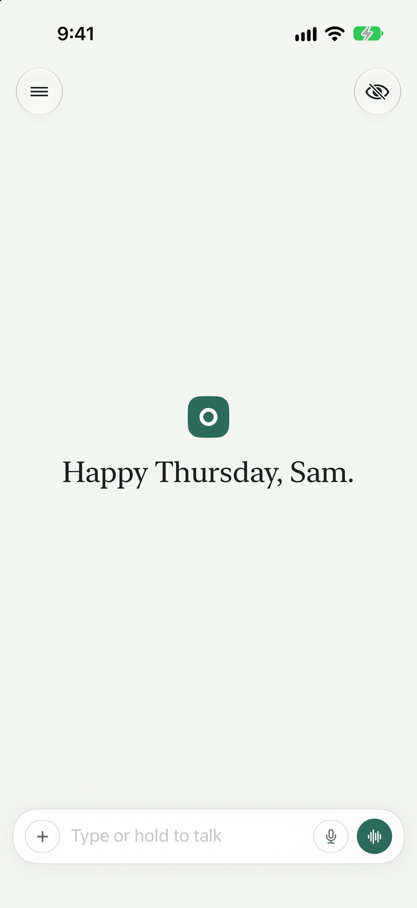
  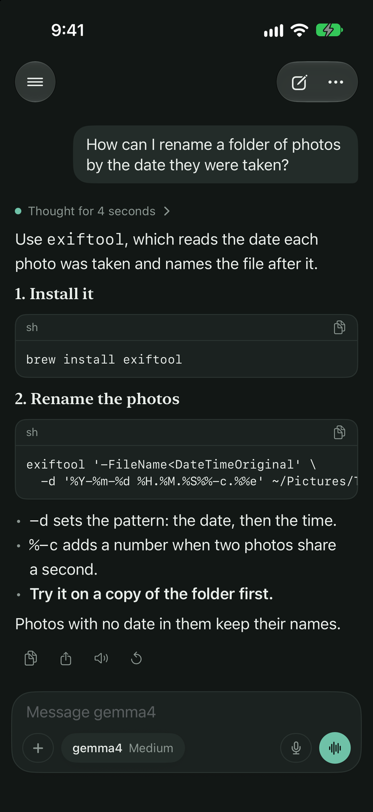
  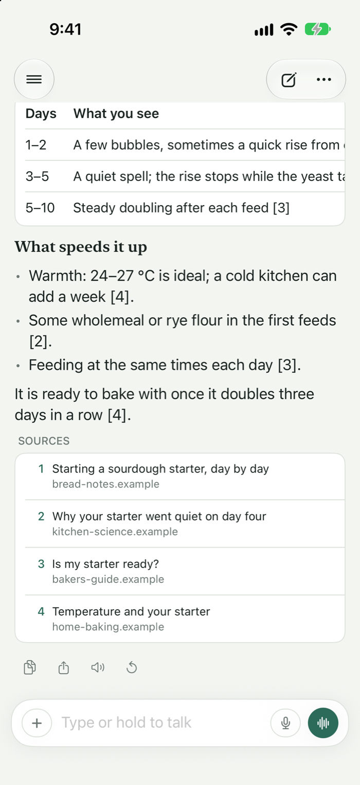
  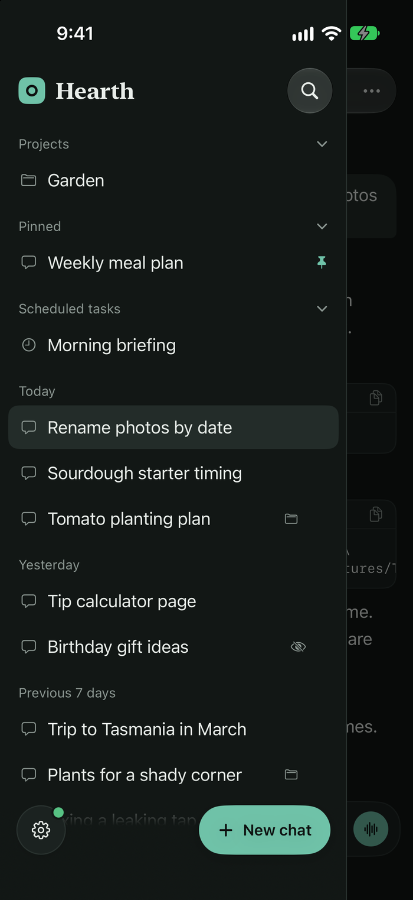
</p>

- **Platform**: iOS and iPadOS 17+, and the Mac through Mac Catalyst; SwiftUI, Swift 5.9+ with strict concurrency checking
- **Dependencies**: none. Only Apple's frameworks
- **Your servers**: Ollama is required; search, speech, pictures and the hub are optional

## What it does

### Chats

- **Any model on your server**, local or cloud, chosen from the composer, with an **effort** for models that think:
  Off, Light, Medium or High
- **Streamed Markdown**: headings, lists, quotes, tables, maths, and coloured code blocks that copy and open full size
- **Web search** through your SearXNG. A model that can call tools searches when it needs to, reads the top pages
  and cites them; the sources show under the reply
- **Deep research**: switch Research on under the + button or in the model sheet, ask a question, and the chat's model plans searches, reads a dozen
  pages, takes notes and writes a report with numbered sources. The steps show while it works
- **Canvas**: a web page, an SVG drawing, a Markdown document or a long piece of code in a reply opens in its own
  panel, beside the chat on an iPad or a Mac, as a sheet on a phone. Pages run their own scripts but cannot reach
  the network. Later versions of the same piece can be stepped through
- **Follow-up questions** under each reply; tap one to ask it
- **Message actions**: copy, share, read aloud, try again (earlier replies are kept as versions), and edit a message
  you sent
- **Documents and photos**: attach PDFs and text files for any model, and photos from the library or the camera for
  models that see
- **Pictures** made on your ComfyUI: + → Make a picture, then describe it, or attach a photo to change it
- **Projects** group chats around one subject, with their own instructions and reference files; long files are
  searched for the passages that bear on each question
- **Memory**: lasting facts the model is told to keep, or that you add in Settings, carried into every chat
- **Private chats** use no memories, add none and are never synced
- **Rename, pin, share or delete** a chat from a long press, or from its menu; search finds chats by title or text

### Voice

- **Voice conversation**: speak, hear the answer in your Kokoro voice, speak again; tap the orb to interrupt
- **The camera in a voice conversation**: with a model that sees, each spoken turn can carry one still of what the
  camera shows ("what is this?")
- **Dictation** into the message, and **hold to talk**: press and hold the composer, speak, let go
- **Read aloud** one reply, or every reply as it is written
- **Siri and Shortcuts**: "Start Voice Conversation"; **widgets** that open a new chat or a voice conversation

### Across your devices

- **Sync** through your own Hearth Hub (Settings → Sync): chats, projects, memories and scheduled tasks, item by item,
  the later change winning. Each person on a hub has their own access key, kept in the device's Keychain. Private
  chats, settings, server addresses and your profile never leave the device
- **Scheduled tasks** (with sync on): a question the hub asks at a time you choose, every day, every week or once,
  optionally searching the web first. Pick a cloud model, or Automatic to let the hub choose. Each answer arrives on
  every device as a new chat, gathered under Scheduled tasks in the chat list. "Schedule a task" under the + button starts
  one from what you were typing
- **Notifications** when a reply or a picture finishes while Hearth is in the background, and when a scheduled task's
  answer arrives. They are made on the device
- **Share to Hearth** from Safari, Photos or Files: the link, text, picture or file lands in the message

### Looks and privacy

- **Lock** behind Face ID, Touch ID, Optic ID or the passcode; the lock also hides Hearth in the app switcher
- **Theme**: follow the system, or keep to light or dark; **vibration** can be turned off
- **iPad**: the chat list stays beside the chat, and the canvas opens beside both. **Mac**: the same app through
  Mac Catalyst
- **Erase all data on this device** returns Hearth to how it was when first opened; the hub and other devices keep
  their copies
- Dynamic Type and VoiceOver labels throughout

## Screenshots

| | | |
|:---:|:---:|:---:|
| 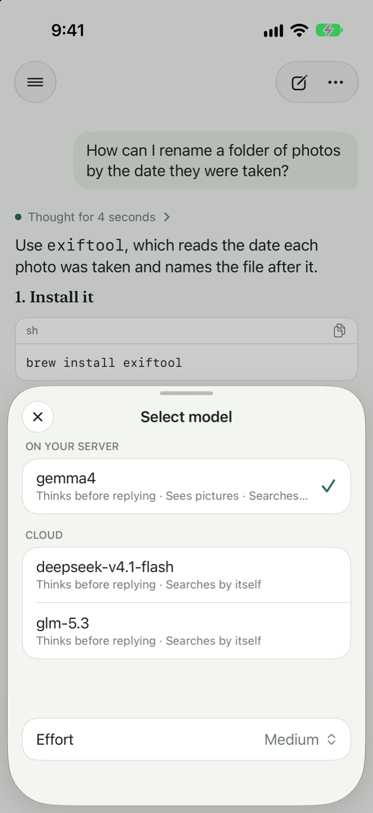<br>Models on your server and in the cloud | 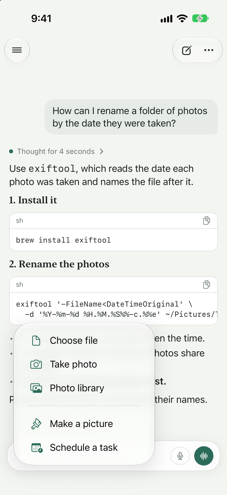<br>The + sheet | 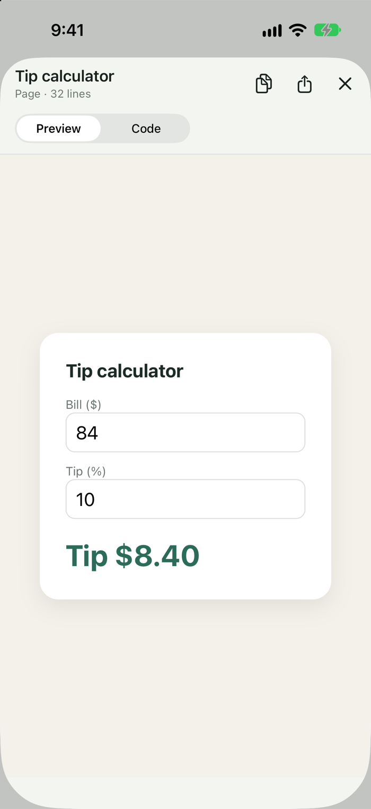<br>A page in the canvas |
| 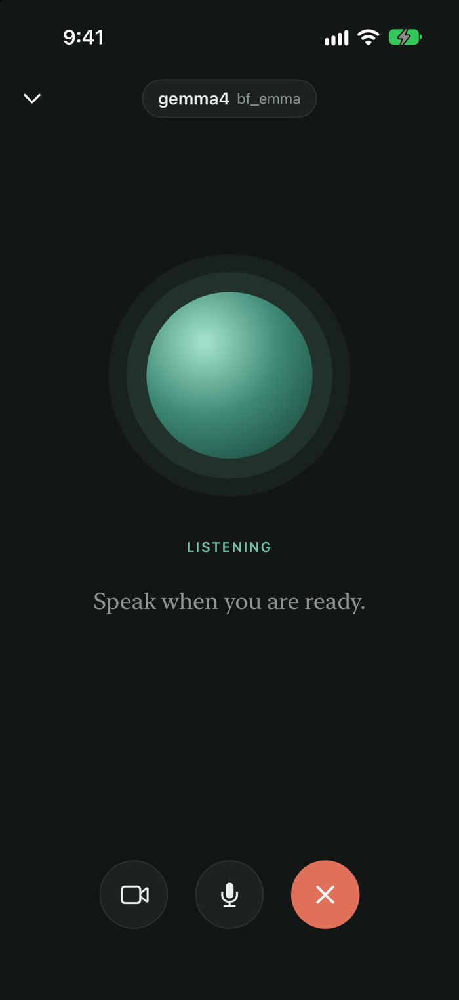<br>Voice conversation | 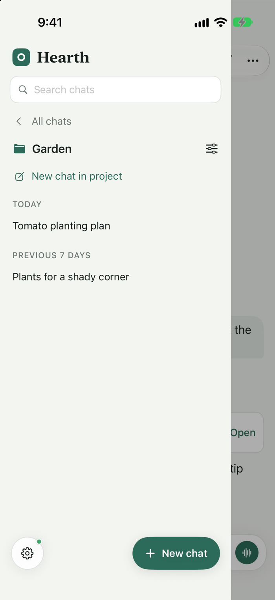<br>A project's chats | 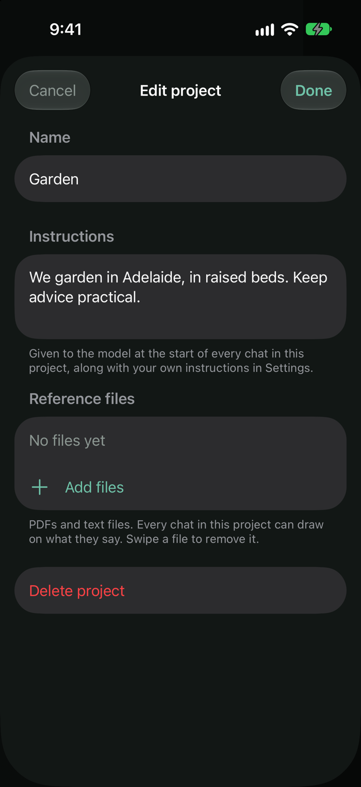<br>A project's instructions |
| 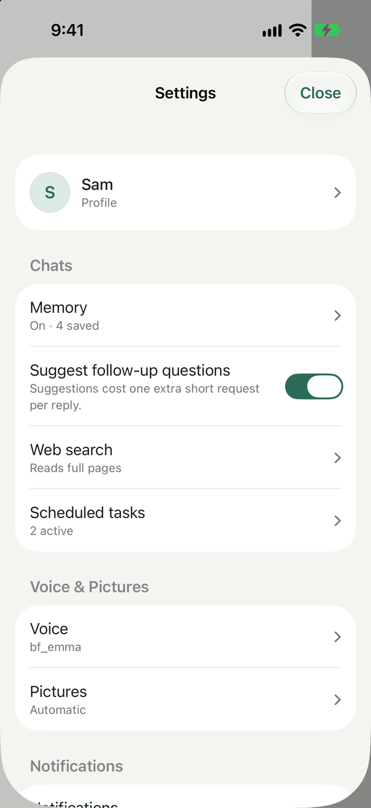<br>Settings | 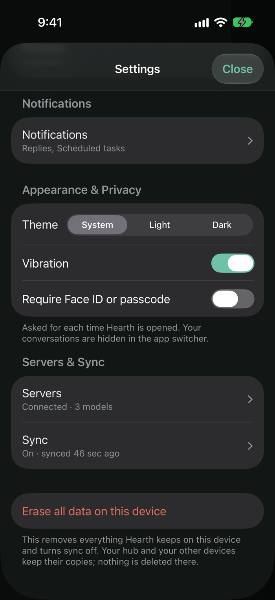<br>More settings | 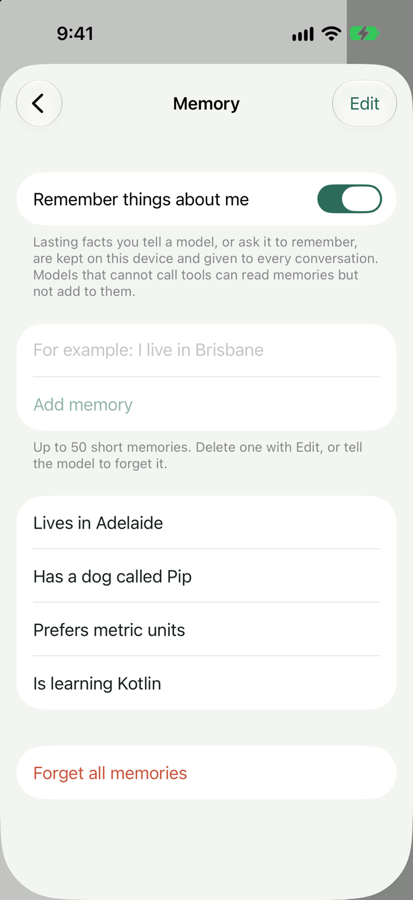<br>Memory |
| 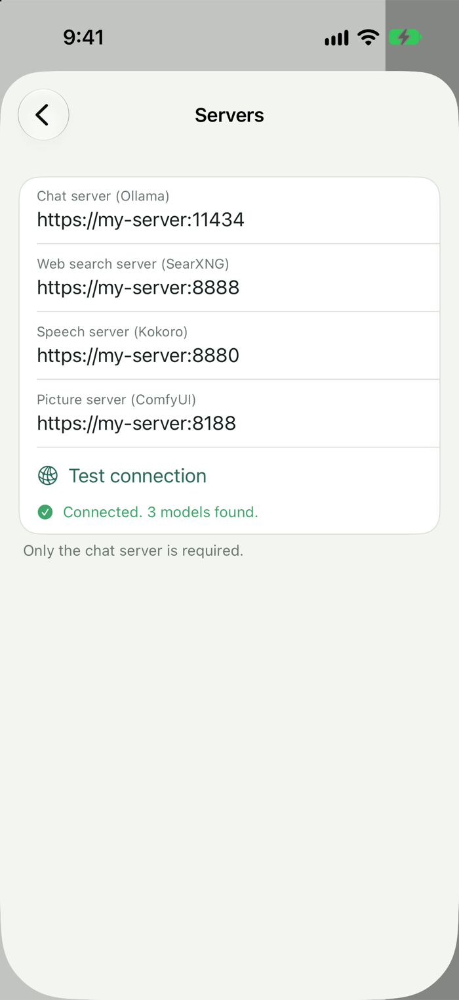<br>Servers | 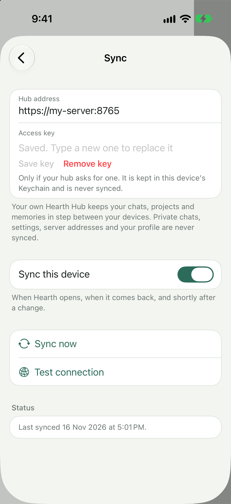<br>Sync with your hub | 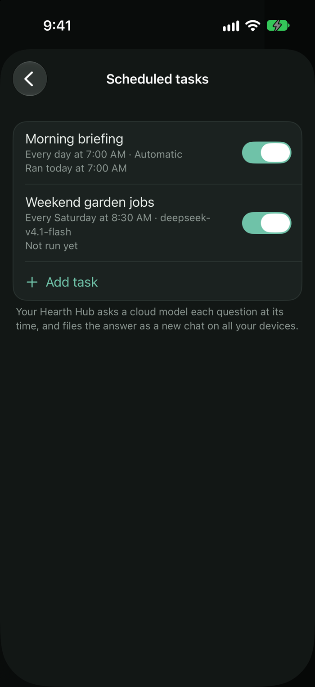<br>Scheduled tasks |
| 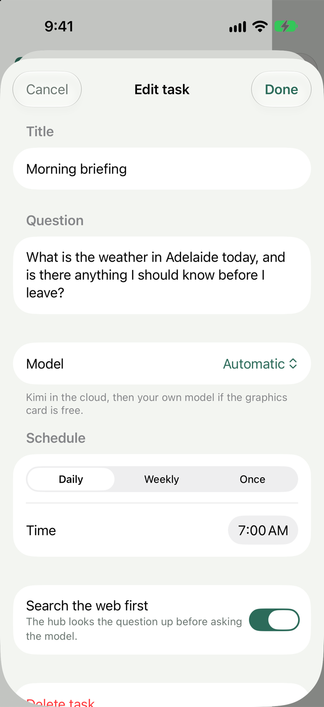<br>Editing a task | 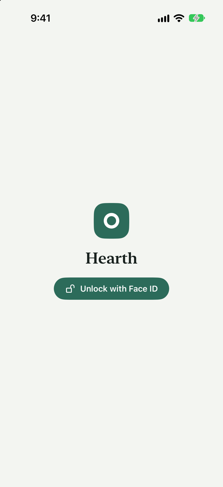<br>Locked | 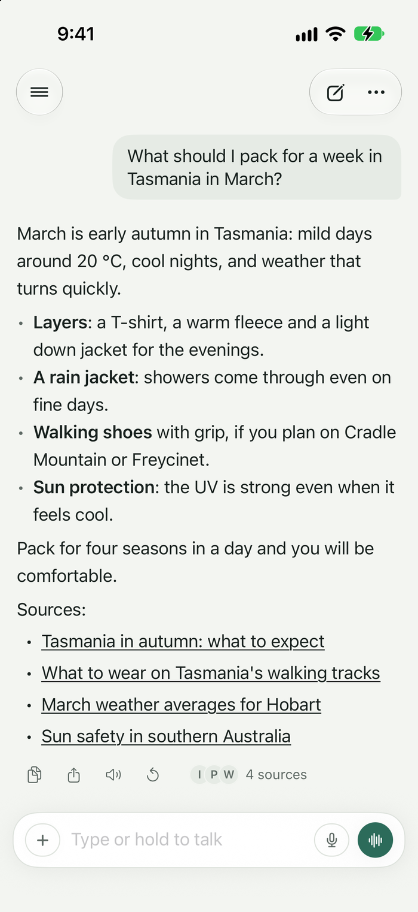<br>A reply with its sources |
| 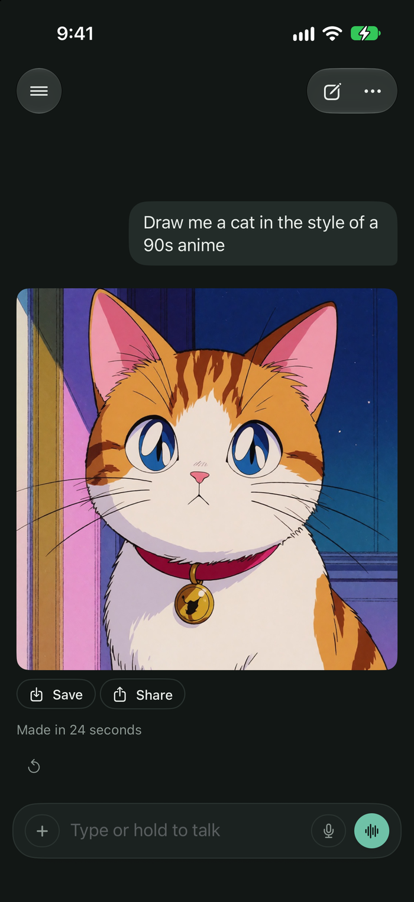<br>A picture made on your server | | |

<p align="center">
  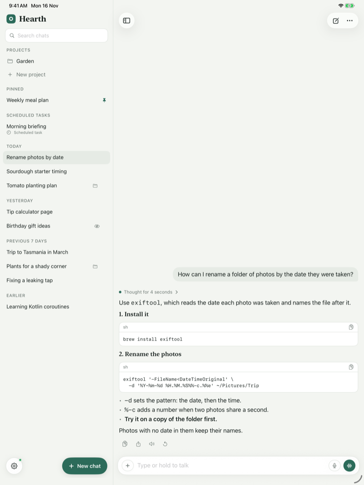
  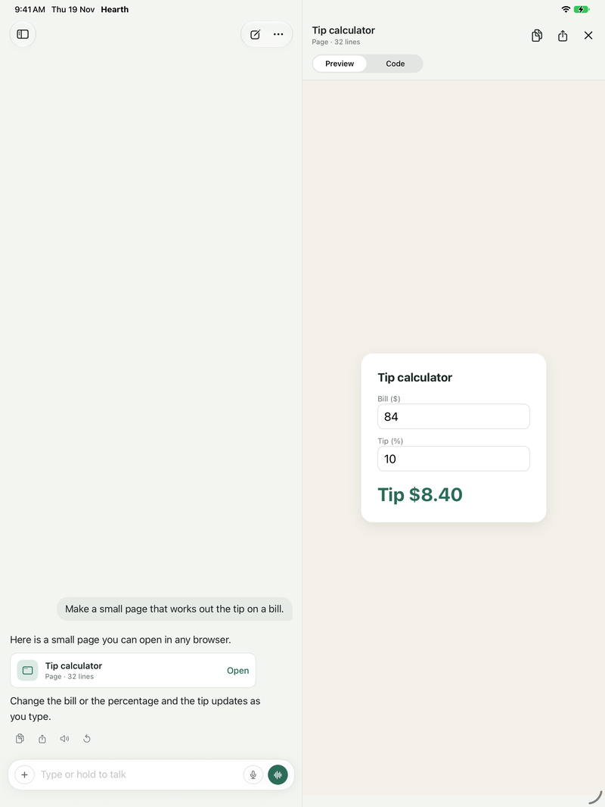
</p>

The pictures use sample data (a made-up Sam, placeholder server addresses); see "Pictures for the README" in
[docs/ARCHITECTURE.md](docs/ARCHITECTURE.md).

## Setting up

You need Xcode 16 or later, [XcodeGen](https://github.com/yonaskolb/XcodeGen) (`brew install xcodegen`), and an Ollama
server Hearth can reach.

```sh
cp Config/Local.example.xcconfig Config/Local.xcconfig   # then fill it in
xcodegen generate
open Hearth.xcodeproj
```

`Config/Local.xcconfig` is ignored by git. It holds:

| Key | What it is |
|---|---|
| `HEARTH_BUNDLE_ID` | Your bundle identifier |
| `HEARTH_DEVELOPMENT_TEAM` | Your signing team |
| `HEARTH_OLLAMA_ADDRESS` | The chat server the app starts with |
| `HEARTH_SEARCH_ADDRESS` | SearXNG, for web search and deep research (optional) |
| `HEARTH_SPEECH_ADDRESS` | Kokoro-FastAPI, for voice (optional) |
| `HEARTH_IMAGE_ADDRESS` | ComfyUI, for pictures (optional) |
| `HEARTH_HUB_ADDRESS` | Your Hearth Hub, offered on the Sync page (optional) |

An xcconfig treats `//` as a comment, so write the slashes of a URL as `/$()/`, as the example file does. Leave an
address empty and the app asks for it; every address can be changed later in Settings → Servers or Settings → Sync.

### Addresses and HTTPS

iOS allows plain `http://` only to hosts on the local network and, in this app, to `*.ts.net` names (Tailscale
already encrypts that traffic). Anything else must be `https://`. A bare IP address over plain HTTP is refused, so
address a tailnet machine by its MagicDNS name.

| Service | Example | On the server |
|---|---|---|
| Ollama | `https://my-server.example.ts.net` | `tailscale serve --bg http://localhost:11434` |
| Search | `https://my-server.example.ts.net:8888` | SearXNG with `json` among its `search.formats` |
| Speech | `http://my-server.example.ts.net:8880` | Kokoro-FastAPI listening on the tailnet |
| Pictures | `http://my-server.example.ts.net:8188` | ComfyUI listening on the tailnet |

### Sync with your own hub

Hearth Hub is a small server of your own, in a separate repository, that keeps a copy of what each device syncs and
runs the scheduled tasks. In Settings → Sync, enter its address and your access key (each person on the hub has their
own), then turn on "Sync this device". Test connection checks that the hub answers. Sync runs when Hearth opens, every minute while
it is open, shortly after a change, in the background now and then, and on "Sync now". The wire format is the hub's
`docs/WIRE_FORMAT.md`.

## Building and testing

```sh
xcodebuild test -project Hearth.xcodeproj -scheme Hearth \
  -destination 'platform=iOS Simulator,name=iPhone 17 Pro'
xcodebuild build -project Hearth.xcodeproj -scheme Hearth \
  -destination 'platform=macOS,variant=Mac Catalyst' -allowProvisioningUpdates
swiftlint lint --strict
python3 Tools/sync_strings.py   # rebuilds Localizable.xcstrings from the Strings*.swift files
```

The tests use Swift Testing and cover the domain (streaming, prompts, search, research, canvas, memory, sync, tasks)
and the presenters. `Spec/` holds test vectors shared with the Android app and the hub. CI runs the tests, SwiftLint,
a check that the string catalog matches the code, and a check that each layer imports only the layers below it.

## Architecture

The app target is a thin shell around a local Swift package, `HearthKit`, in four layers that only depend downwards:

```
HearthUI      Coordinator, Presenters, ViewModels, SwiftUI views       (@MainActor)
HearthDomain  Models, Interactors, Stores, DataProviders, Transformers  (Sendable)
HearthData    Services and DTOs: Ollama, SearXNG, Kokoro, ComfyUI, web pages, the hub,
              files, Keychain, audio, dictation, camera, notifications   (Sendable)
HearthCore    Tagged identifiers, logging
```

Each screen has a View, an observable ViewModel and a Presenter (MVVMP+C); dependencies are structs of closures with
a `.live` version. [docs/ARCHITECTURE.md](docs/ARCHITECTURE.md) explains the layers, how a screen is wired, sync,
research, the canvas and scheduled tasks; [docs/DESIGN_SYSTEM.md](docs/DESIGN_SYSTEM.md) lists the tokens and
components.

## Privacy

- **Your data stays on your devices and your servers.** Chats, projects and memories are JSON files in the app's own
  folder, and reach your hub only if you turn sync on. Choosing a cloud model sends that chat to the cloud host your
  Ollama server forwards it to.
- **Never synced**: private chats, settings, server addresses, your profile and photo, and the access key, which stays
  in the Keychain.
- **Web pages are read by the device.** The top results of a search are fetched by your phone, so those sites see its
  address, and each source's site is asked for its small icon to show beside the source. Turn this off in
  Settings → Web search to send snippets only and fetch neither.
- **Photos stay on the device until you send one.** The + sheet shows your latest photos only if you allow it; say
  no and the Photos button still opens the system's own picker, which shows the app nothing but what you pick.
- **Untrusted text is fenced.** Search results and pages are marked to the model as material, not instructions, and
  a page in the canvas cannot load anything from the network or open links.
- **Memory is cautious**: at most 50 short memories, and nothing is remembered in a chat that holds web results, a
  file or a photo.
- **Notifications are made on the device**; a private chat's says only that a reply is ready.

## Good to know

- **Maths is shown as text**, `x² ≤ a/b`, on one line rather than typeset.
- **Files are read as text.** PDFs need a text layer. A file, or a project's files together, beyond 60,000
  characters is searched for the passages that share words with your question, and those are what the model reads.
- **Local models are given room for the chat**: the app asks your server for a context of 8k to 128k tokens as a
  chat grows, since a server's own default is often 4k. Larger sizes use more of the server's memory.
- **Deep research is bounded**: at most 8 searches and 16 pages, which is about 15 to 20 requests to the chat's
  model. It takes under a minute with a cloud model and longer with a large local one.
- **Sync is last writer wins, per item**, by each device's clock; messages are not merged. A chat larger than 20 MB
  stays on the device.
- **A reply keeps streaming briefly in the background**, as long as iOS allows.
- The app icon is drawn by `python3 Tools/make_icon.py` (needs Pillow).

## Licence

[MIT](LICENSE).
