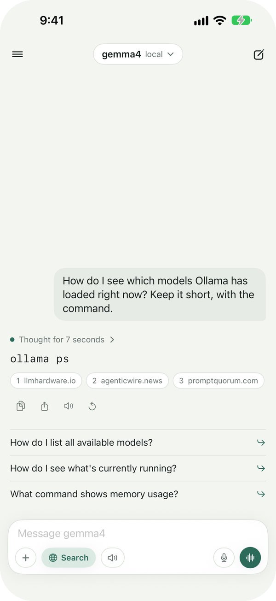
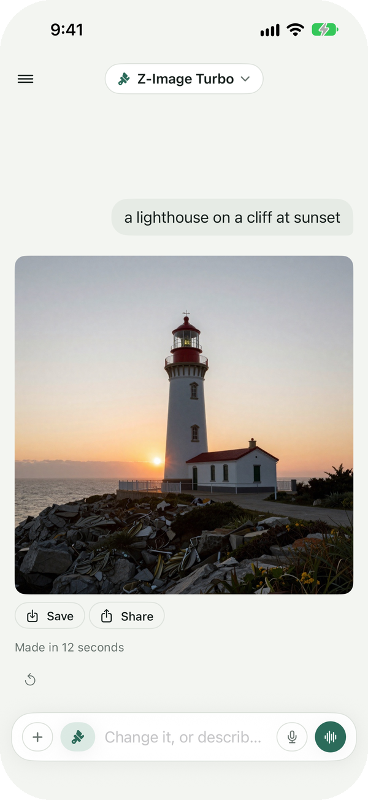
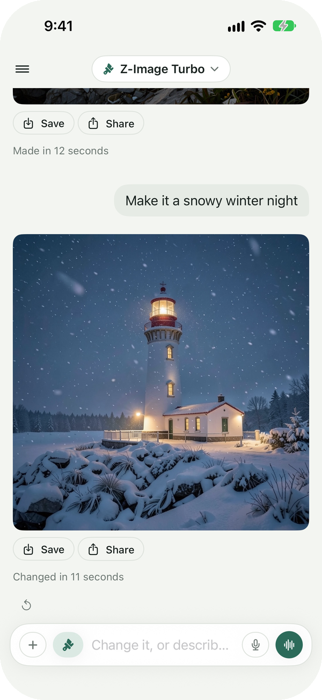
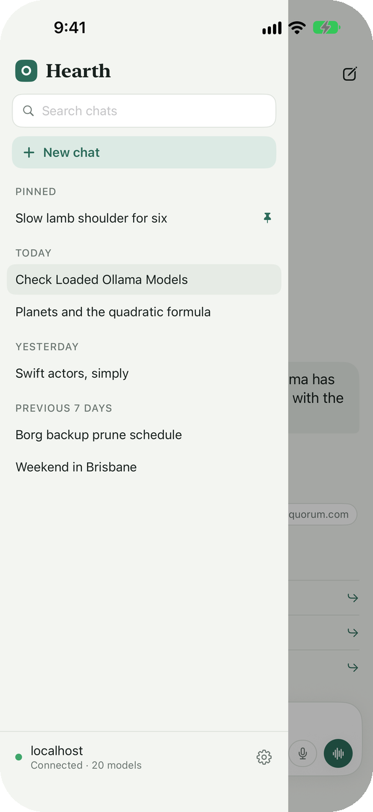
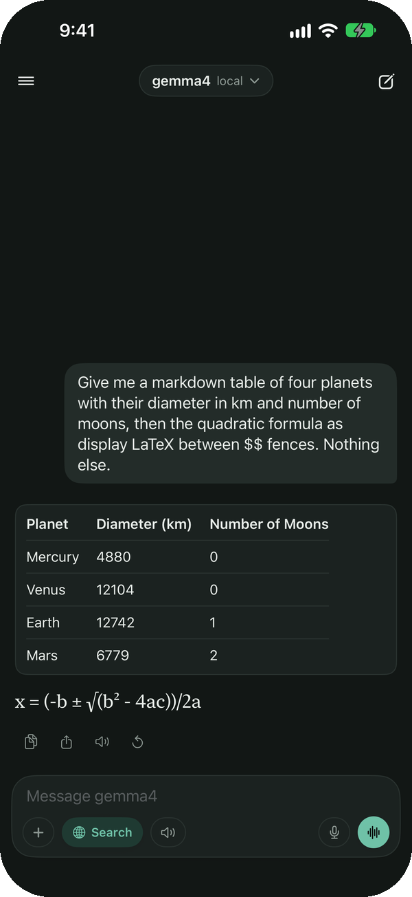
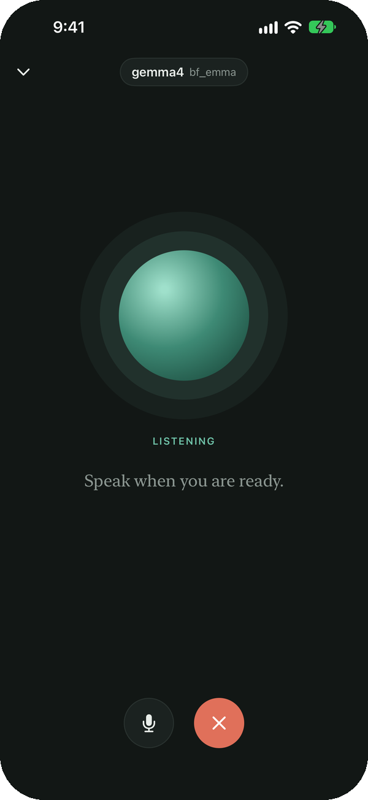
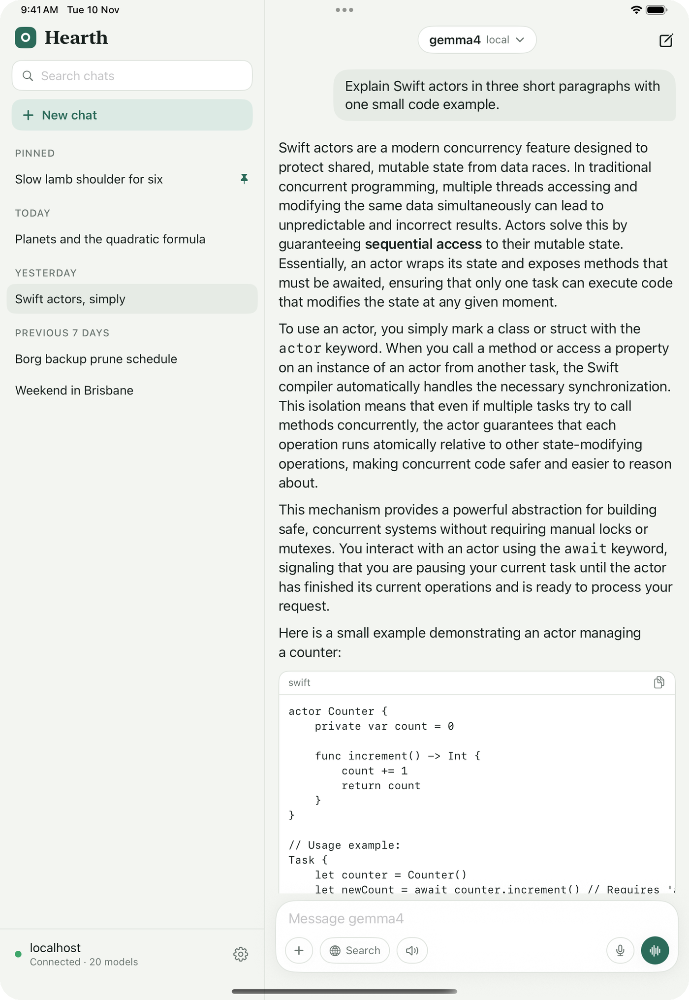
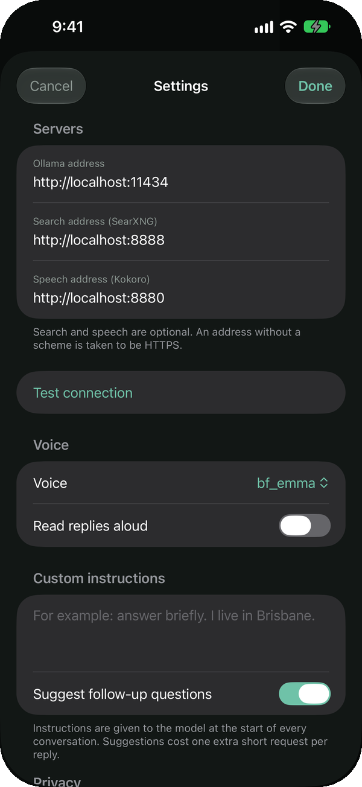

# Hearth

[](https://github.com/cliftonia/Hearth/actions/workflows/ci.yml)


A native iPhone, iPad and Mac chat app for your own [Ollama](https://ollama.com) server. Pick any model
the server offers, chat with streamed replies, search the web through your own SearXNG, and talk
hands-free with replies spoken by your own Kokoro voice. Nothing goes through anyone else's cloud,
and your conversations stay on the device.

<p align="center">
  
  
  
  
</p>
<p align="center">
  
  
</p>

- **Platform**: iOS and iPadOS 17+, and the Mac through Mac Catalyst; SwiftUI, Swift 5.9+ with strict concurrency checking
- **Dependencies**: none. SwiftUI, Speech, AVFoundation, PDFKit, LocalAuthentication and App Intents only
- **Talks to**: Ollama for chat, [SearXNG](https://github.com/searxng/searxng) for web search,
  [Kokoro-FastAPI](https://github.com/remsky/Kokoro-FastAPI) for speech and ComfyUI for pictures; the last three are optional

## What it does

### Chat

- **Any model on the server**, chosen from a picker that groups local and cloud models
- **Streamed Markdown**: headings, lists, quotes, tables and code blocks you can copy
- **Maths** written in LaTeX shown as readable text, `x² ≤ a/b`, on one line rather than typeset
- **Thinking** folded away under "Thought for N seconds", with a level of Off, Light, Medium or High for models that reason
- **Web search when it is needed**: a model that can call tools searches SearXNG on its own, asks for news when the
  question is about current events, reads the top pages it finds and cites its sources; for a model that cannot call
  tools, a toggle searches before it replies
- **Deep research**: choose it as the effort in the model sheet, after Light, Medium and High, and ask a question.
  Hearth has the chat's own model plan a handful of searches, runs them on your SearXNG, reads a dozen of the pages
  found, takes notes on each, looks once more for anything important that is missing, and writes a report that cites
  its sources as `[1]`, `[2]`, with the numbered sources listed beneath it. The steps show while it works, Stop ends
  it at once, and Try again researches again. The choice stays with its chat and is never saved, so a new chat is
  never researched by accident
- **Canvas**: a web page, a drawing in SVG, a Markdown document or a long block of code in a reply is folded into
  a card, and the card opens it in a panel of its own: beside the chat on an iPad in landscape or a Mac, as a
  full-height sheet on a phone. A page, a drawing or a document can be seen as it is meant to look or as it was
  written, and copied or shared. Ask for a change and the panel follows the new version as it is written, with
  arrows to step back to earlier ones. A page runs its own scripts but is shut off from the network
- **Suggested follow-up questions** under each reply; tap one to ask it
- **A composer that stays out of the way**: one row at rest, opening out while you write to show the options for
  the reply: web search, how hard to think, and reading aloud
- **Hold to talk**: press and hold the resting composer to dictate, with dots that follow your voice; let go and
  the words are in the message, ready to read and send. The microphone button still dictates with a tap
- **A greeting by name** on an empty chat, which varies from chat to chat and sometimes names the day
- **Attachments**: photos from the library or camera for models that can see, PDFs and text files for any model
- **Edit and resend** a message you already sent
- **Reply versions**: asking again keeps the earlier reply, and arrows under the reply step between them
- **Pictures**, made on your own [ComfyUI](https://github.com/comfyanonymous/ComfyUI): tap + and choose Make a picture, then
  describe one. Attach a photo to have it changed as you ask, or enlarged; a follow-up such as "make it night" changes
  the last picture. The menu at the top then offers the picture models the server has. The chat model is unloaded
  before each picture and the picture server frees its memory after it
- **Share to Hearth** from Safari, Photos or Files: the link, text, picture or file lands in the message being written
- **A profile**: your full name, a nickname and a photo, kept on the device. An empty chat greets you by your
  nickname, and the model is told what to call you
- **Custom instructions**, on the profile page, given to the model at the start of every conversation
- **Memory**: lasting facts you tell a model, or ask it to remember, are kept on the device and carried into every
  conversation. A notice shows whenever something is remembered, and the list can be read, added to and cleared in Settings
- **Private chat**: the eye-slash button at the top right of an empty chat makes it private, so it uses no memories
  and adds none

### Voice

- **Voice conversation**: speak, pause, hear the answer, speak again; tap the orb to interrupt
- **Voice with the camera**: with a model that sees pictures, the camera button in a voice conversation shows what
  the camera sees in a card above the orb. Each time you finish speaking, one still picture goes with your words, so
  you can ask "what is this?" or "read that label". It is kept on your message in the chat like any attached photo.
  Nothing is recorded, the camera starts off every time, and it goes off when the conversation closes or Hearth
  leaves the screen
- **Read aloud**: one reply at a time, or every reply with the speaker option in the composer, spoken sentence by
  sentence while it is still being written
- **Hear this voice**: Settings plays a short sample of the chosen voice before you keep it
- **Dictation** into the message field, recognised on the device where the phone supports it
- **Shortcut**: "Start Voice Conversation" from Siri, Shortcuts, Spotlight or the Action button
- **Widgets** for the home screen and the lock screen that open a new chat or a voice conversation

### Your conversations

- **History** in a drawer, grouped by day, searchable and titled by the model
- **Settings and New chat** float at the bottom of the chat list; a dot on the Settings button shows whether the
  server can be reached
- **Pin, rename, share as Markdown, delete** from a long press
- **Projects** gather chats around one subject: every chat in a project is given the project's instructions,
  on top of your own, and can draw on its reference files (PDFs and text). File a chat from a long press or from
  its menu; deleting a project keeps its chats
- **Lock** behind Face ID, Touch ID or the passcode; the lock covers the app switcher and every sheet
- **Notifications** when a reply or a picture finishes while Hearth is not on screen, made on the device itself.
  Tapping one opens its chat; a private chat's says only that a reply is ready
- **Erase all data on this device**: there are no accounts, so the profile page offers to erase the chats, projects,
  memories, profile and saved settings instead, leaving the app as it was when first opened. It wipes this device
  only and turns sync off; nothing is deleted from the hub or your other devices
- **On the device**: JSON files in the app's own folder, and synced only if you turn sync on
- **Sync between your devices**, through your own [Hearth Hub](#sync-with-your-own-hub) (Settings → Sync, off by
  default): ordinary chats with their messages, reply versions, pictures, research reports and sources, pins and
  projects; projects with their instructions and files; and memories. Private chats, settings, server addresses, the
  profile and its photo, and the hub's access token never leave the device. It syncs when Hearth opens, when it comes
  back to the front, a few seconds after a change, and on "Sync now"; a reply still being written is sent once it
  has finished

### Look

- **Theme**: follow the system, or keep to light or dark
- **Haptics**: a light tap as a message is sent, a reply finishes or something is switched, with one switch in
  Settings to silence them all
- **iPad**: conversations stay beside the chat on a wide screen
- **Mac**: the same app, built with Mac Catalyst
- Dynamic Type and VoiceOver labels throughout

<p align="center">
  
</p>

## Setting up

You need Xcode 16 or later and [XcodeGen](https://github.com/yonaskolb/XcodeGen) (`brew install xcodegen`).

```sh
cp Config/Local.example.xcconfig Config/Local.xcconfig   # then fill it in
xcodegen generate
open Hearth.xcodeproj
```

`Config/Local.xcconfig` holds your bundle identifier, signing team and the server addresses the app
starts with. It is ignored by git, so none of them reach the repository. Leave the addresses empty
and the app asks for them in Settings on first launch; they can be changed there at any time.

<p align="center">
  
</p>

### Addresses and HTTPS

iOS only allows plain `http://` to hosts on the local network and, in this app, to `*.ts.net` names
(Tailscale already encrypts that traffic). Anything else must be `https://`. A bare IP address over
plain HTTP is refused by the system, so address a tailnet machine by its MagicDNS name.

| Service | Example | On the server |
|---|---|---|
| Ollama | `https://my-server.example.ts.net` | `tailscale serve --bg http://localhost:11434` |
| Search | `https://my-server.example.ts.net:8888` | SearXNG with `json` among its `search.formats` |
| Speech | `http://my-server.example.ts.net:8880` | Kokoro-FastAPI listening on the tailnet |

### Sync with your own hub

Hearth Hub is a small server of your own, kept in a separate repository, that holds a copy of what each device
syncs. In Settings → Sync, enter its address, an access token if it asks for one (kept in the Keychain, never in
the settings or a file), and turn on "Sync this device". The same App Transport Security rules apply as for your
other servers: plain `http://` only to a local-network name or a `*.ts.net` one, `https://` anywhere else. A copy
changed on two devices is settled by the later change, item by item; a deletion travels as a tombstone. The exact
format is the hub's `docs/WIRE_FORMAT.md`.

## Architecture

The app target is a thin shell around a local Swift package, `HearthKit`, split into four modules
that only depend downwards:

```
HearthUI      Coordinator, Presenters, ViewModels, SwiftUI views       (@MainActor)
HearthDomain  Models, Interactors, Stores, DataProviders, Transformers  (Sendable)
HearthData    Services and DTOs: Ollama, SearXNG, Kokoro, files, audio  (Sendable)
HearthCore    Tagged identifiers, logging
```

- **MVVMP+C**: each screen has a View, an `@Observable` ViewModel and a Presenter that owns it.
  Presenters ask the `AppCoordinator` for navigation through delegates.
- **Dependencies are closures**: data providers are structs of `@Sendable` functions with a `.live`
  implementation, so tests pass in their own.
- **Errors** are thrown raw by the data layer, given meaning in the domain (`ChatError`) and caught
  in the Presenter, which shows them in a banner.
- **Untrusted text**: a model's reply, a search result and a web page are all treated as untrusted. Only `http` and
  `https` links open when tapped. Pages are read only from public HTTPS addresses, never from a private, tailnet or
  numeric one; a redirect is held to the same rule, and a page is discarded unless the connection is confirmed to
  have reached a public address. Page text is reduced in a single pass that hostile markup cannot slow down. Each
  result's title, snippet and page text are handed to the model inside a fence with a marker made up afresh for
  every search, marked as material, not instructions.
- **Generated pages**: a page or a drawing shown in the canvas was written by a model, so it is untrusted too. It is
  loaded from a string with no address of its own into a web view that keeps nothing, may run its own scripts,
  and can fetch nothing: every `http`, `https` and WebSocket request is blocked, every navigation away from the
  page is cancelled, so a tapped link opens nothing, and it is given no window, camera, microphone or files, and no
  peer connection in any frame.
- **Design system**: colours, type, spacing, radii, sizes and shadows are tokens, and views use nothing else.
- **Strings** live in `Localizable.xcstrings`, rebuilt from `Strings.swift` by `python3 Tools/sync_strings.py`.

More in [docs/ARCHITECTURE.md](docs/ARCHITECTURE.md), which covers the layers, how a screen is wired and how to add
one, and [docs/DESIGN_SYSTEM.md](docs/DESIGN_SYSTEM.md), which lists the tokens, the components and the rules for
using them.

## Tests and linting

```sh
xcodebuild test -project Hearth.xcodeproj -scheme Hearth \
  -destination 'platform=iOS Simulator,name=iPhone 17 Pro Max'
xcodebuild build -project Hearth.xcodeproj -scheme Hearth \
  -destination 'platform=macOS,variant=Mac Catalyst'
swiftlint lint
```

Tests are written with Swift Testing: the stream decoding, prompt building, sentence chunking for
speech and the feed that reads a reply aloud, Markdown, maths and web page parsing, memory and its limits, follow-up questions, export, the chat interactor, the
conversation store, file storage, which addresses a page may be read from, the app lock, the drawer's grouping, the profile and
the greeting, erasing everything, when a finished reply is announced and in what words, the camera of a voice
conversation (when it runs, when it stops, and the picture sent with a spoken turn), the canvas (which parts of a
reply are pieces, their kinds and titles, fences left open or nested, which pieces are versions of one another,
what a generated page may load and where it may go, and how the columns share a wide screen), and deep research: reading
a model's plan, choosing and spreading sources, tidying citations, the order of its steps, its bounds, stopping it and
what it does when nothing can be read; and sync: every synced model to the wire and back (reply versions, pictures,
research and fields from a newer app kept), which copy wins, tombstones both ways, private chats never sent, a
streaming chat put off, a refused older copy replaced by the hub's, paging, the settings page, when syncs run, and
that erasing sends nothing. The codebase holds a zero-warning SwiftLint bar.

The same checks run on every push and pull request through GitHub Actions (`.github/workflows/ci.yml`), together with
a check that the string catalog matches `Strings.swift` and that each layer imports only the layers beneath it.

## Good to know

- **Maths is an approximation.** Fractions are written on one line and constructs with no plain-text
  form, such as matrices, stay close to how the model wrote them.
- **Files are read as text.** PDFs need a text layer, and each file is cut at 60,000 characters.
- **The voice conversation stops listening while a reply is spoken**, so it cannot hear itself.
- **The camera sends stills, not video.** One picture is taken as you stop speaking, shrunk to at most 1,280 pixels
  on its longer side like any attached photo, and sent with that turn; if none can be taken the words go alone. It
  is asked for the first time you turn it on, and a model that cannot see leaves the button disabled. A picture in
  a chat closes memory for the rest of it, as an attached photo does. Turned off by Hearth leaving the screen, it
  stays off until you turn it on again. The simulator has no camera, so a debug build there shows a drawn test
  card instead.
- **A canvas piece is a fenced block.** A page or a drawing counts at any length, by its language tag or by how it
  begins; a document or code counts from 15 lines. Shorter blocks stay in the reply as before. Nothing more is
  saved: the pieces are read from the reply's text each time, and an open canvas closes with its chat.
- **Versions are matched simply.** A later piece is a version of the open one when it is the same kind and either
  has the same title or is the only piece in its reply. Two unrelated pages each alone in a reply are therefore
  offered as versions of one another.
- **A page in the canvas cannot reach the network**, so one that loads a script, a font or a picture from a web
  address shows without it, and its links open nothing. Peer connections are taken away in the page and in every
  frame it makes, and a frame cannot be given a `sandbox`: one that would be out of reach is removed. Measured on
  the simulator, no frame leaks and DNS prefetching and preconnecting cause no lookups. The frame sealing is a
  script rather than a rule the engine enforces, so a way to make a frame it does not know of could reopen it. Line numbers are left off code that holds characters the
  monospaced face lacks, such as emoji, since they would drift out of step.
- **Follow-up questions and chat titles each cost one short extra request** to the same model.
  Follow-ups can be turned off in Settings.
- **Memory is deliberately cautious.** At most 50 short memories and two changes a turn. Nothing can be remembered in
  a conversation that has searched the web or carries a file or a photo, from that point on, so a page, a document
  or the text in a picture cannot plant a memory. A model cannot change or forget a memory you wrote by hand. Models that cannot call tools read
  memories but cannot add to them.
- **Thinking levels are a request.** Ollama accepts them for every thinking model, but some models think
  as much as they please whatever the level.
- **A model may search the web up to three times in one turn**, after which it is told to answer from what it has.
- **Reading pages is done by the device.** The top three results of a search are fetched directly and reduced to
  text, so those sites see the device's address rather than the server's. It can be turned off in Settings, leaving
  the model with snippets only. A page can still try to mislead the model; marking its text as untrusted lowers that
  risk but cannot remove it.
- **Deep research is bounded.** At most 5 planned searches and 3 more to fill a gap, 12 pages and then 4 more, no
  more than 2 pages from one site, 4 pages fetched at once, 12 seconds for a page, 6,000 characters read from each
  and 24,000 characters of notes handed to the writer. That is about 15 to 20 requests to the model, all to the one
  the chat already uses; a run took about 40 seconds with a cloud model, and will take minutes with a large local one.
  Pages are read by the device under the same rule as any search's pages. If no page can be read, or none says
  anything about the question, it says so and writes nothing. It needs a search address; without one the choice is
  listed but cannot be made
- **Sync is last writer wins, per item.** Two devices changing the same chat before they sync keep the later
  change and lose the earlier one, whole; messages are not merged. The comparison uses each device's clock, so a
  device whose clock is badly wrong can win or lose unfairly (the hub refuses times more than a day ahead). A
  conversation is sent whole, pictures included, each time it changes; one larger than 20 MB of JSON stays on the
  device and the status line says so. A memory saved with the same words on two devices before they first sync is
  kept twice
- **A reply keeps streaming for a short while in the background**, as long as iOS allows, usually about half a minute.
- The app icon is drawn by `python3 Tools/make_icon.py` (needs Pillow).
