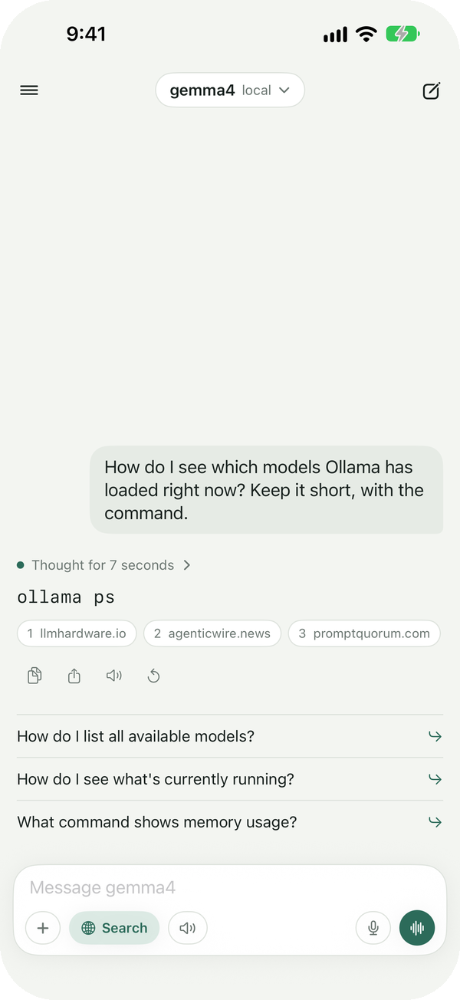
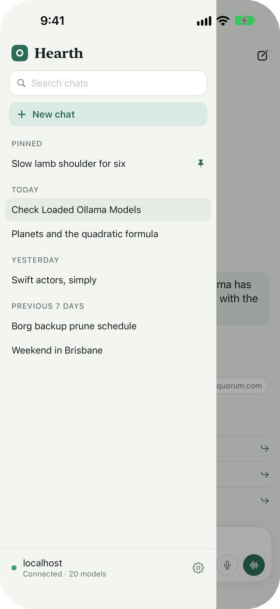
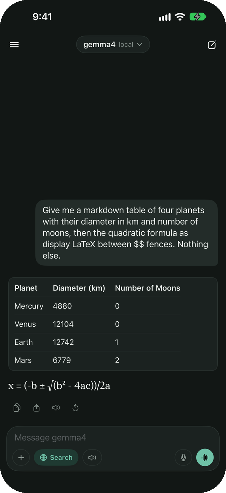
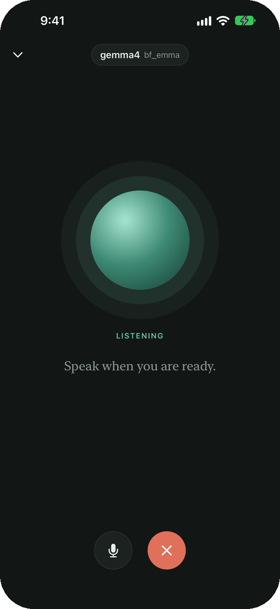
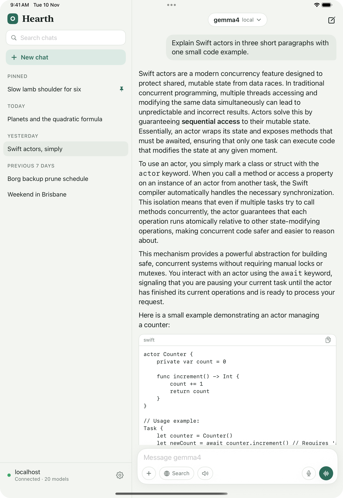
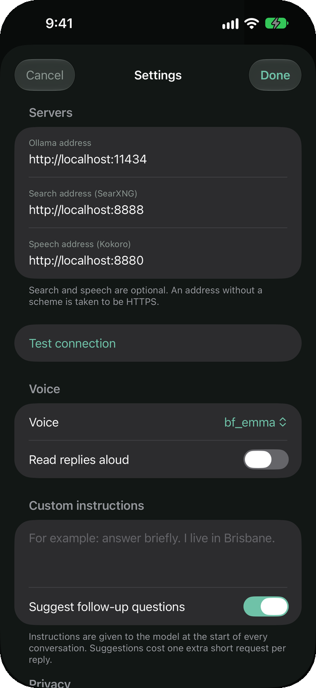

# Hearth


A native iPhone and iPad chat app for your own [Ollama](https://ollama.com) server. Pick any model
the server offers, chat with streamed replies, search the web through your own SearXNG, and talk
hands-free with replies spoken by your own Kokoro voice. Nothing goes through anyone else's cloud,
and your conversations stay on the device.

<p align="center">
  
  
  
  
</p>

- **Platform**: iOS and iPadOS 17+, SwiftUI, Swift 5.9+ with strict concurrency checking
- **Dependencies**: none. SwiftUI, Speech, AVFoundation, PDFKit, LocalAuthentication and App Intents only
- **Talks to**: Ollama for chat, [SearXNG](https://github.com/searxng/searxng) for web search and
  [Kokoro-FastAPI](https://github.com/remsky/Kokoro-FastAPI) for speech; the last two are optional

## What it does

### Chat

- **Any model on the server**, chosen from a picker that groups local and cloud models
- **Streamed Markdown**: headings, lists, quotes, tables and code blocks you can copy
- **Maths** written in LaTeX shown as readable text, `x² ≤ a/b`, on one line rather than typeset
- **Thinking** folded away under "Thought for N seconds", with a level of Off, Light, Medium or High for models that reason
- **Web search when it is needed**: a model that can call tools searches SearXNG on its own, asks for news when the
  question is about current events, reads the top pages it finds and cites its sources; for a model that cannot call
  tools, a toggle searches before it replies
- **Suggested follow-up questions** under each reply; tap one to ask it
- **Attachments**: photos from the library or camera for models that can see, PDFs and text files for any model
- **Edit and resend** a message you already sent
- **Custom instructions** given to the model at the start of every conversation
- **Memory**: lasting facts you tell a model, or ask it to remember, are kept on the device and carried into every
  conversation. A notice shows whenever something is remembered, and the list can be read, added to and cleared in Settings
- **Private chat**: a new chat can be made private, so it uses no memories and adds none

### Voice

- **Voice conversation**: speak, pause, hear the answer, speak again; tap the orb to interrupt
- **Read aloud**: one reply at a time, or every reply with the speaker toggle in the composer, spoken sentence by
  sentence while it is still being written
- **Dictation** into the message field, recognised on the device where the phone supports it
- **Shortcut**: "Start Voice Conversation" from Siri, Shortcuts, Spotlight or the Action button

### Your conversations

- **History** in a drawer, grouped by day, searchable and titled by the model
- **Pin, rename, share as Markdown, delete** from a long press
- **Lock** behind Face ID, Touch ID or the passcode; the lock covers the app switcher and every sheet
- **On the device only**: JSON files in the app's own folder, synced nowhere

### Look

- **Theme**: follow the system, or keep to light or dark
- **iPad**: conversations stay beside the chat on a wide screen
- Dynamic Type and VoiceOver labels throughout

<p align="center">
  
</p>

## Setting up

You need Xcode 16 or later and [XcodeGen](https://github.com/yonaskolb/XcodeGen) (`brew install xcodegen`).

```sh
cp Config/Local.example.xcconfig Config/Local.xcconfig   # then fill it in
xcodegen generate
open Hearth.xcodeproj
```

`Config/Local.xcconfig` holds your bundle identifier, signing team and the server addresses the app
starts with. It is ignored by git, so none of them reach the repository. Leave the addresses empty
and the app asks for them in Settings on first launch; they can be changed there at any time.

<p align="center">
  
</p>

### Addresses and HTTPS

iOS only allows plain `http://` to hosts on the local network and, in this app, to `*.ts.net` names
(Tailscale already encrypts that traffic). Anything else must be `https://`. A bare IP address over
plain HTTP is refused by the system, so address a tailnet machine by its MagicDNS name.

| Service | Example | On the server |
|---|---|---|
| Ollama | `https://my-server.example.ts.net` | `tailscale serve --bg http://localhost:11434` |
| Search | `https://my-server.example.ts.net:8888` | SearXNG with `json` among its `search.formats` |
| Speech | `http://my-server.example.ts.net:8880` | Kokoro-FastAPI listening on the tailnet |

## Architecture

The app target is a thin shell around a local Swift package, `HearthKit`, split into four modules
that only depend downwards:

```
HearthUI      Coordinator, Presenters, ViewModels, SwiftUI views       (@MainActor)
HearthDomain  Models, Interactors, Stores, DataProviders, Transformers  (Sendable)
HearthData    Services and DTOs: Ollama, SearXNG, Kokoro, files, audio  (Sendable)
HearthCore    Tagged identifiers, logging
```

- **MVVMP+C**: each screen has a View, an `@Observable` ViewModel and a Presenter that owns it.
  Presenters ask the `AppCoordinator` for navigation through delegates.
- **Dependencies are closures**: data providers are structs of `@Sendable` functions with a `.live`
  implementation, so tests pass in their own.
- **Errors** are thrown raw by the data layer, given meaning in the domain (`ChatError`) and caught
  in the Presenter, which shows them in a banner.
- **Untrusted text**: a model's reply, a search result and a web page are all treated as untrusted. Only `http` and
  `https` links open when tapped. Pages are read only from public HTTPS addresses, never from a private, tailnet or
  numeric one; a redirect is held to the same rule, and a page is discarded unless the connection is confirmed to
  have reached a public address. Page text is reduced in a single pass that hostile markup cannot slow down. Each
  result's title, snippet and page text are handed to the model inside a fence with a marker made up afresh for
  every search, marked as material, not instructions.
- **Strings** live in `Localizable.xcstrings`, rebuilt from `Strings.swift` by `python3 Tools/sync_strings.py`.

## Tests and linting

```sh
xcodebuild test -project Hearth.xcodeproj -scheme Hearth \
  -destination 'platform=iOS Simulator,name=iPhone 17 Pro Max'
swiftlint lint
```

Tests are written with Swift Testing: the stream decoding, prompt building, sentence chunking for
speech, Markdown, maths and web page parsing, memory and its limits, follow-up questions, export, the chat interactor, the
conversation store, file storage, which addresses a page may be read from, the app lock and the drawer's grouping. The codebase holds a
zero-warning SwiftLint bar.

## Good to know

- **Maths is an approximation.** Fractions are written on one line and constructs with no plain-text
  form, such as matrices, stay close to how the model wrote them.
- **Files are read as text.** PDFs need a text layer, and each file is cut at 60,000 characters.
- **The voice conversation stops listening while a reply is spoken**, so it cannot hear itself.
- **Follow-up questions and chat titles each cost one short extra request** to the same model.
  Follow-ups can be turned off in Settings.
- **Memory is deliberately cautious.** At most 50 short memories and two changes a turn. Nothing can be remembered in
  a conversation that has searched the web or carries a file or a photo, from that point on, so a page, a document
  or the text in a picture cannot plant a memory. A model cannot change or forget a memory you wrote by hand. Models that cannot call tools read
  memories but cannot add to them.
- **Thinking levels are a request.** Ollama accepts them for every thinking model, but some models think
  as much as they please whatever the level.
- **A model may search the web up to three times in one turn**, after which it is told to answer from what it has.
- **Reading pages is done by the device.** The top three results of a search are fetched directly and reduced to
  text, so those sites see the device's address rather than the server's. It can be turned off in Settings, leaving
  the model with snippets only. A page can still try to mislead the model; marking its text as untrusted lowers that
  risk but cannot remove it.
- **A reply keeps streaming for a short while in the background**, as long as iOS allows, usually about half a minute.
- The app icon is drawn by `python3 Tools/make_icon.py` (needs Pillow).
