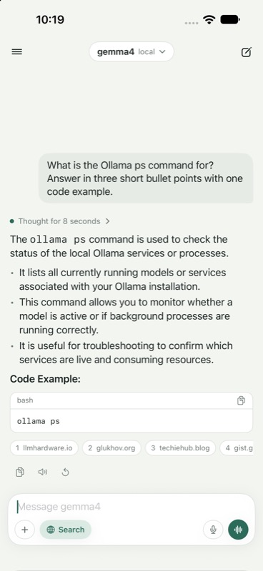
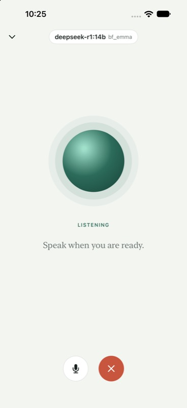

# Hearth

A native iOS chat app for your own [Ollama](https://ollama.com) server. Pick any model the server offers, chat with streamed replies, search the web through your own SearXNG, and talk hands-free with replies spoken by your own Kokoro voice. Conversations stay on the phone.

<p>
  
  
</p>

## Features

- **Chat** with any model on the server, chosen from a picker that groups local and cloud models. Replies stream in as Markdown with headings, lists, quotes, tables and copyable code blocks.
- **Maths** written in LaTeX is shown as readable Unicode text (`x² ≤ a/b`). It is an approximation on one line, not typesetting.
- **Thinking** from models that reason is folded away under a "Thought for N seconds" line.
- **Attachments**: photos from the library or the camera for models that can see, and PDFs or text files for any model.
- **Edit and resend** a message you already sent; the replies after it are replaced.
- **Custom instructions** in Settings are given to the model at the start of every conversation.
- **Web search** per message: results from SearXNG are handed to the model and shown as source links under the reply.
- **Dictation** into the message field, recognised on the device where the phone supports it.
- **Read aloud**: any reply spoken through a Kokoro (OpenAI-compatible) speech server.
- **Voice conversation**: speak, pause, hear the answer, speak again. Tap the orb to interrupt. A "Start Voice Conversation" shortcut opens it from Siri, Shortcuts, Spotlight or the Action button.
- **History** in a drawer, grouped by day, searchable and titled by the model. Chats can be pinned, renamed, shared as Markdown and deleted.
- **Theme**: follow the system, or keep to light or dark.
- **Read every reply aloud**, if you turn it on in Settings.
- **Lock** behind Face ID, Touch ID or the passcode, with conversations hidden in the app switcher.
- **iPad**: the conversations stay beside the chat on a wide screen.
- Dynamic Type and VoiceOver labels throughout.

## Requirements

- Xcode 16 or later, iOS 17 or later
- [XcodeGen](https://github.com/yonaskolb/XcodeGen) to generate the project (`brew install xcodegen`)
- An Ollama server the phone can reach. A private network such as Tailscale is the intended setup.
- Optional: a [SearXNG](https://github.com/searxng/searxng) instance with the `json` format enabled, and a [Kokoro-FastAPI](https://github.com/remsky/Kokoro-FastAPI) server for speech.

There are no third-party Swift dependencies.

## Setup

```sh
cp Config/Local.example.xcconfig Config/Local.xcconfig   # then fill it in
xcodegen generate
open Hearth.xcodeproj
```

`Config/Local.xcconfig` holds your bundle identifier, signing team and the server addresses the app starts with. It is ignored by git, so none of them reach the repository. Leave the addresses empty and the app asks for them in Settings on first launch; they can be changed there at any time.

### Addresses and HTTPS

iOS only allows plain `http://` to hosts on the local network and, in this app, to `*.ts.net` names (Tailscale already encrypts that traffic). Anything else must be `https://`. A bare IP address over plain HTTP is refused by the system, so address a tailnet machine by its MagicDNS name:

| Service | Example |
|---------|---------|
| Ollama  | `https://my-server.example.ts.net` (through `tailscale serve`) |
| Search  | `https://my-server.example.ts.net:8888` |
| Speech  | `http://my-server.example.ts.net:8880` |

## Architecture

The app target is a thin shell around a local Swift package, `HearthKit`, split into four modules that only depend downwards:

```
HearthUI      Coordinator, Presenters, ViewModels, SwiftUI views       (@MainActor)
HearthDomain  Models, Interactors, Stores, DataProviders, Transformers  (Sendable)
HearthData    Services and DTOs: Ollama, SearXNG, Kokoro, files, audio  (Sendable)
HearthCore    Tagged identifiers, logging
```

- **MVVMP+C**: each screen has a View, an `@Observable` ViewModel and a Presenter that owns it. Presenters ask the `AppCoordinator` for navigation through delegates.
- **Dependencies are closures**: data providers are structs of `@Sendable` functions with a `.live` implementation, so tests pass in their own.
- **Errors** are thrown raw by the data layer, given meaning in the domain (`ChatError`) and caught in the Presenter, which shows them in a banner.
- **Strings** live in `Localizable.xcstrings`, generated from `Strings.swift` by `python3 Tools/sync_strings.py`.

## Tests and linting

```sh
xcodebuild test -project Hearth.xcodeproj -scheme Hearth -destination 'platform=iOS Simulator,name=iPhone 17 Pro Max'
swiftlint lint
```

Tests are written with Swift Testing and cover the stream decoding, prompt building, sentence chunking for speech, Markdown and maths parsing, export, the chat interactor, the conversation store, file storage, the app lock and the drawer's grouping.

## Notes

- Conversations are stored as JSON files in the app's Application Support folder and are not synced anywhere.
- The voice conversation stops listening while a reply is spoken, so it cannot hear itself. Interrupt by tapping the orb.
- The app icon is drawn by `python3 Tools/make_icon.py` (needs Pillow).
